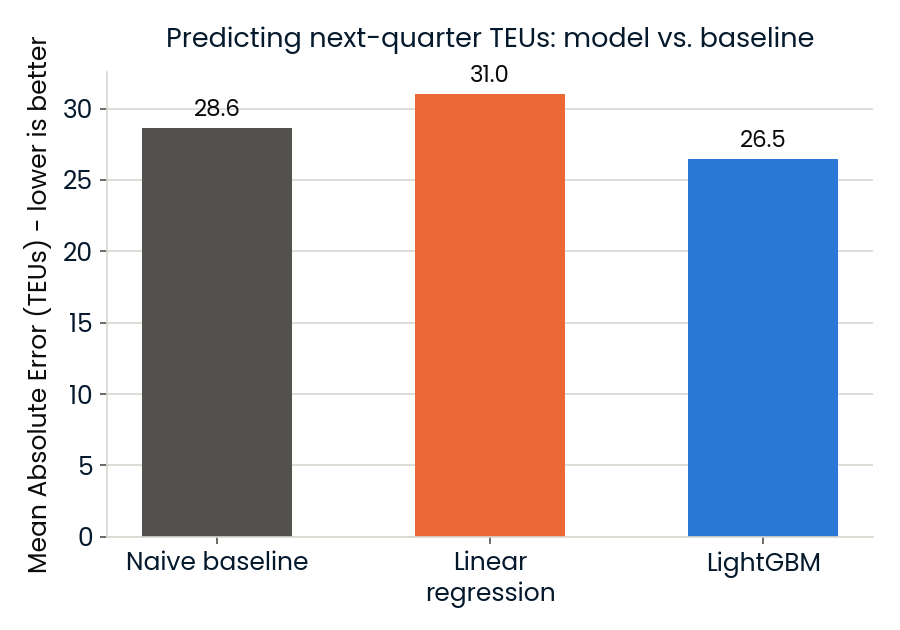
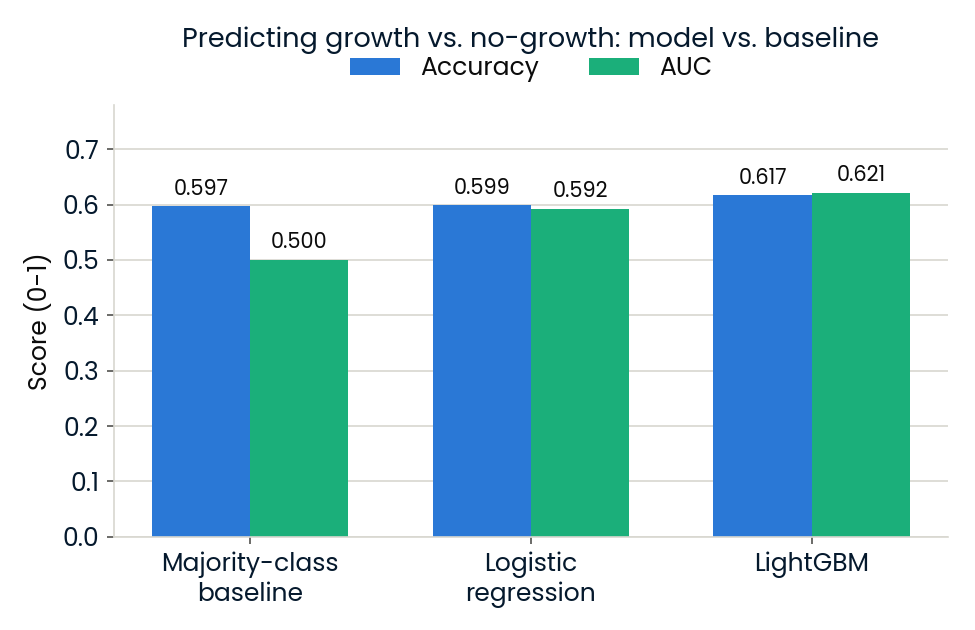
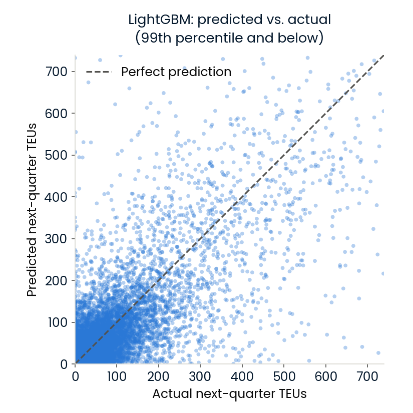
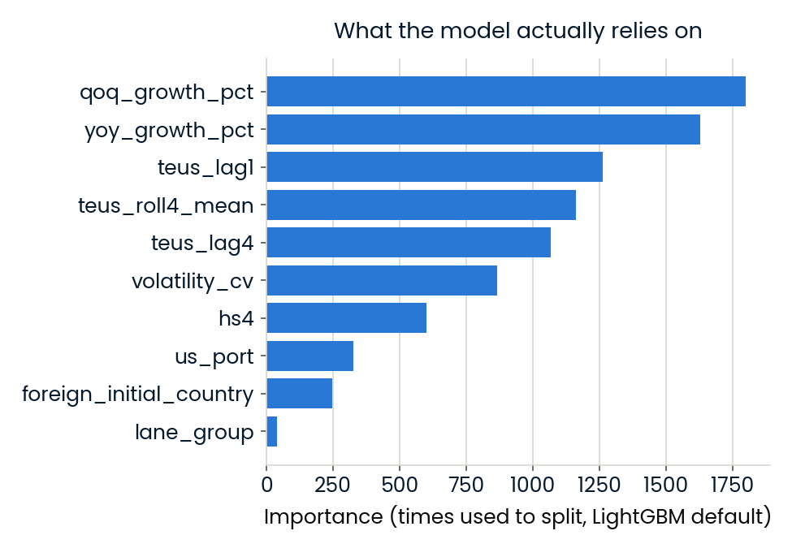

# JAXPORT Container Volume Forecasting

Forecasting monthly and quarterly import container volumes (TEUs) for JAXPORT trade lanes from **2.3 million U.S. trade records (2021–2025)**. The goal was to find which lanes can be forecast reliably and which are likely to grow, so the port can prioritize growth opportunities.

**Main finding:** Most lanes are too sparse to forecast, so I first sorted lanes by demand pattern and kept the 3,805 forecastable lanes that carry **91.8% of volume**. On those lanes, "same as last month" was a hard baseline to beat. SARIMA and linear regression did worse than it. LightGBM beat it, cutting error by **7.5%**, and a logistic regression growth classifier reached **0.69 AUC** (65% accuracy against a 58% majority-class baseline).

---

## Data

- **Source:** U.S. containerized trade records, 2021–2025 (2,322,953 rows, 20 columns: direction, date, HS4 commodity, origin country, U.S. port, value, metric tons, TEUs)
- **Scope:** imports only, with commodities coded at the 4-digit HS level
- **Lane:** one U.S. port + one HS4 commodity (the quarterly models also split lanes by origin country)
- **Train/test split:** trained on 2021–2024, tested on all 12 months of 2025

> The raw trade data is not included in this repository. The notebook expects `JaxPort Data-2021-2025.csv` in the working directory.

## Approach

**1. Cleaning**
- Removed rows with zero or negative TEUs or value (10,414 rows)
- Dropped records coded only at the 2-digit chapter level
- Capped value per TEU at the 99.9th percentile to limit the effect of data-entry outliers
- Filled every lane–month with no shipments with zero, building a complete 18,107-lane × 60-month panel

**2. Lane segmentation (forecastability screen)**

71% of lane–months had no shipments. I classified each lane by how often it shipped (ADI, the average interval between shipments) and how much shipment size varied (CV²), using the standard Syntetos–Boylan cutoffs:

| Segment | Lanes | Share of 2021–24 volume | Kept for modeling |
|---|---|---|---|
| Smooth | 1,143 | 66.2% | Yes |
| Erratic | 1,475 | 23.0% | Yes |
| Intermittent | 1,187 | 2.6% | Yes |
| Lumpy | 3,144 | 6.8% | No |
| Sporadic | 11,158 | 1.4% | No |

**3. Features**

Each feature uses only data from before the month being predicted, which prevents data leakage: TEUs lagged 1, 2, 3 and 12 months; 3-, 6- and 12-month rolling averages; each lane's 2021–24 average; its segment; and the calendar month.

**4. Models**
- **Baselines:** last month's value, and the same month last year
- **Time series:** SARIMA(1,1,1)(1,0,0)₁₂, fitted separately for each of the 3,805 lanes
- **Regression:** linear regression and LightGBM for TEU volume
- **Classification:** logistic regression and LightGBM to predict whether a lane grows

## Results

**Volume forecasts (2025, quarterly, 3,805 lanes)**

| Model | MAE (TEUs per lane) | WAPE | WAPE: Smooth | WAPE: Erratic | WAPE: Intermittent |
|---|---|---|---|---|---|
| Naive: last month | 27.1 | **15.7%** | 10.9% | 27.4% | 34.6% |
| SARIMA | 36.6 | 21.2% | 16.9% | 30.7% | 49.7% |
| Linear regression | 45.3 | 26.2% | 20.1% | 39.0% | 71.0% |
| Naive: same month last year | 68.5 | 39.6% | 30.9% | 59.3% | 90.4% |

In a separate quarterly setup where lanes were also split by origin country, **LightGBM reached an MAE of 26.5, 7.5% better than the naive baseline (28.6)**. Linear regression scored 31.0.

**Growth classification (will a lane ship more than last month?)**

| Lane group | Accuracy | Majority-class baseline | AUC |
|---|---|---|---|
| All lanes | **64.9%** | 57.5% | **0.69** |
| Smooth | 64.3% | 53.1% | 0.69 |
| Erratic | 62.3% | 55.7% | 0.67 |
| Intermittent | 73.6% | 73.2% | 0.67 |

## Takeaways

- **Segment before modeling.** Port volume is highly concentrated: 21% of lanes carry 92% of TEUs. Modeling only forecastable lanes made the results more reliable and easier to interpret.
- **Simple baselines are hard to beat.** Seasonality was weak and changed from year to year, so models built around a seasonal cycle (SARIMA, same-month-last-year) did worse than predicting last month's value.
- **Predicting which lanes will grow works better than predicting exact volumes.** The growth classifier clearly beat its baseline on Smooth and Erratic lanes, which makes it useful for ranking lanes by growth potential.

## Charts

## Files

- `notebook.ipynb`: the full pipeline, covering cleaning, segmentation, features, models and charts
- `eval_utils.py`: shared functions for loading data, scoring, building features and training/test splits, so every model is scored the same way

## Tools

Python (pandas, NumPy, statsmodels, scikit-learn, LightGBM, Matplotlib), SQL, DataCamp DataLab, Power BI
